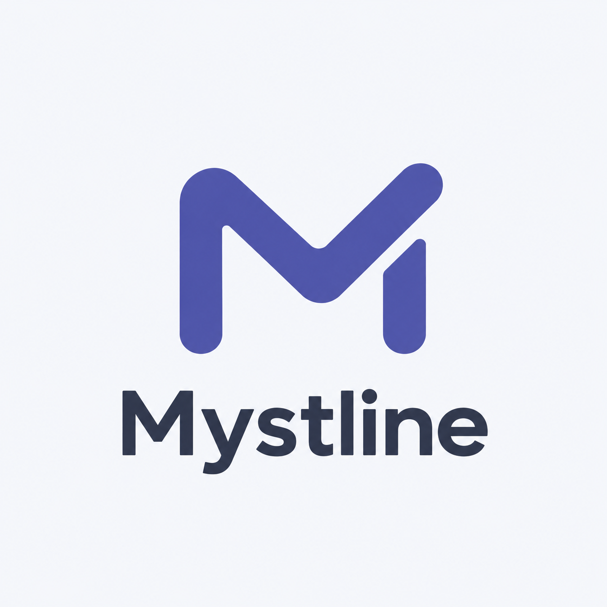
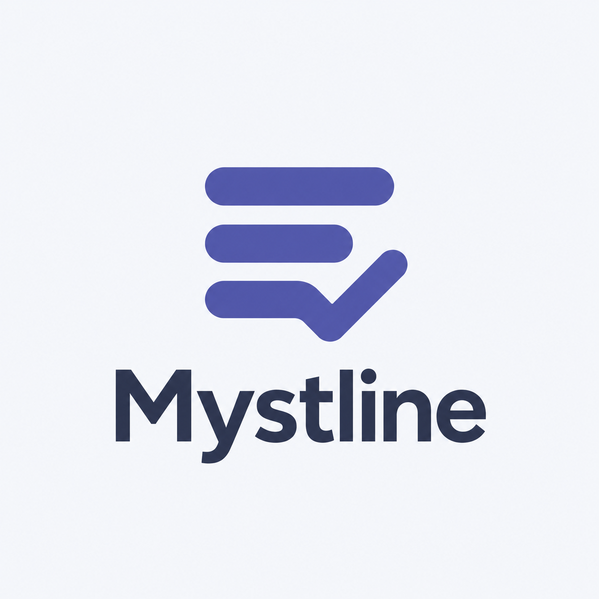
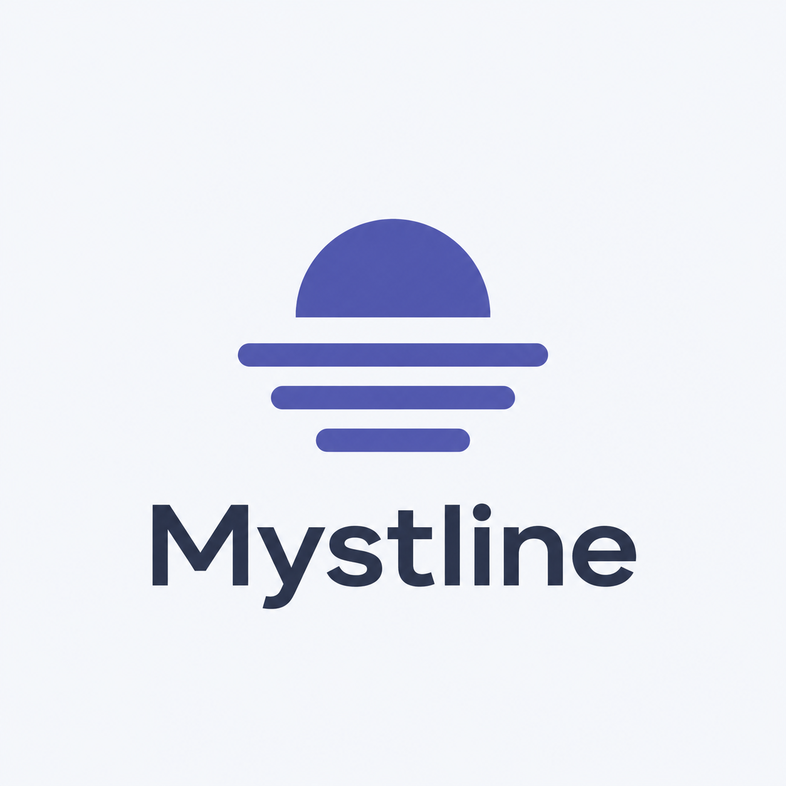

# Propositions de logos Mystline

Date : 14 octobre 2026.

Trois pistes adaptées à la direction Brume Indigo de la maquette. Visuels exploratoires PNG générés avec l’outil intégré image_gen.

**Choix validé le 14 octobre 2026 : proposition 02, « Lignes et coche ».** Le symbole associe trois lignes de tâches à une coche intégrée à la dernière ligne.

La déclinaison finale utilise l’indigo `#4E54A5`, un fond transparent et le texte `#293247`. Le mot-symbole est en Noto Sans gras, converti en tracés pour ne pas dépendre des polices installées.

- [Symbole SVG](mystline-mark.svg)
- [Logo avec le nom, en SVG](mystline-logo.svg)
- [Logo avec le nom, en PNG transparent](mystline-logo.png)

La source du symbole est [frontend/public/mystline-mark.svg](../../../frontend/public/mystline-mark.svg). L’interface et le favicon la consomment directement. Les exports PNG, ICO et RGBA pour le tray Linux et Windows sont dérivés de cette source par [scripts/export-icons.py](../../../scripts/export-icons.py). Exécuter `python3 scripts/export-icons.py` avec PyGObject/Rsvg, Pycairo, Pillow et la police Noto Sans installés. Ces outils servent uniquement à régénérer les assets ; ils ne sont pas nécessaires au lancement de Mystline.

## 1. Monogramme M



### Prompt utilisé

```text
Use case: logo-brand. Asset type: logo proposal for Mystline, a calm, minimal local desktop task capture app. Create one polished flat vector-like logo presentation, square composition, ample whitespace, pale cool background #F5F7FB. Main mark above a carefully typeset wordmark. Text verbatim: "Mystline" (M y s t l i n e), modern sans serif, dark slate #293247, medium weight. Palette: indigo #4E54A5 and dark slate, optionally pale indigo #E7EAF9. Crisp edges, balanced negative space, strong silhouette readable as a small tray icon. Show only one main symbol and the wordmark. No explanatory text, numbering, slogans, gradients, shadows, 3D, texture, photography or mockup objects. Concept 1: a distinctive abstract uppercase M drawn with one continuous thick geometric line with gently softened corners; the right rising stroke subtly implies a completed check gesture. Compact balanced near-square symbol, memorable disciplined proportions. The M remains the primary reading. Brand mood: immediate capture, fluid action, quiet confidence.
```

## 2. Lignes et coche



### Prompt utilisé

```text
Use case: logo-brand. Asset type: logo proposal for Mystline, a calm, minimal local desktop task capture app. Create one polished flat vector-like logo presentation, square composition, ample whitespace, pale cool background #F5F7FB. Main mark above a carefully typeset wordmark. Text verbatim: "Mystline" (M y s t l i n e), modern sans serif, dark slate #293247, medium weight. Palette: indigo #4E54A5 and dark slate, optionally pale indigo #E7EAF9. Crisp edges, balanced negative space, strong silhouette readable as a small tray icon. Show only one main symbol and the wordmark. No explanatory text, numbering, slogans, gradients, shadows, 3D, texture, photography or mockup objects. Concept 2: a compact emblem of three horizontal task lines arranged into a balanced square silhouette, the lowest line connects into a clear upward checkmark. Use a bold simple recognizable shape with deliberate negative space, unified stroke thickness and gently rounded ends. The checklist and completion gesture are one coherent symbol. Brand mood: clarity, order, satisfaction of completing a task.
```

## 3. Horizon de brume



### Prompt utilisé

```text
Use case: logo-brand. Asset type: logo proposal for Mystline, a calm, minimal local desktop task capture app. Create one polished flat vector-like logo presentation, square composition, ample whitespace, pale cool background #F5F7FB. Main mark above a carefully typeset wordmark. Text verbatim: "Mystline" (M y s t l i n e), modern sans serif, dark slate #293247, medium weight. Palette: indigo #4E54A5 and dark slate, optionally pale indigo #E7EAF9. Crisp edges, balanced negative space, strong silhouette readable as a small tray icon. Show only one main symbol and the wordmark. No explanatory text, numbering, slogans, gradients, shadows, 3D, texture, photography or mockup objects. Concept 3: an abstract horizon emblem inspired by mist and the name Mystline. Three short thick horizontal indigo lines in stepped lengths, above them a single simple rising semicircle separated by clear negative space. A compact minimalist geometric silhouette suggesting clarity emerging above a quiet horizon, sturdy enough for a tiny tray icon. No sun rays, no literal clouds, no landscape illustration. Brand mood: calm, a clear day, breathing room.
```

